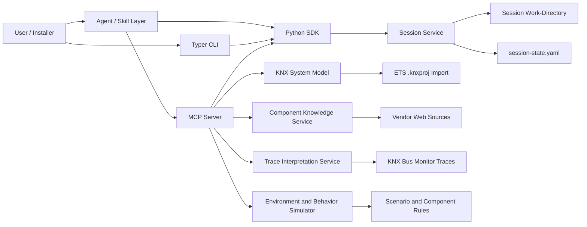

# Architecture 001: KNX Investigation Platform

## Architecture update package

- affected_documents:
  - `docs/methodology/02-terminology-dictionary.md`
  - `docs/architecture/001-knx-investigation-platform.md`
  - `docs/implementation/003-proposed-capability-apis.md`
- change_type: `update`
- story_03_clarification: Story 03 (session service) clarifies section 2b without changing boundaries. Decision (2026-10-24): sessions are resolved only by explicit `session_label` (replaces "Resolves active-session context"); all sessions live under a configurable session root; the refresh check is applied in the application layer via a separate `ProjectRefreshGuard` (arch-b, internal structure); the fingerprint is deferred (field present, `null`). Details: `docs/implementation/003-proposed-capability-apis.md`, section "Session service realisation (story 03)".
- story_04_clarification: Story 04 (`.knxproj` import and project graph) clarifies section 3 and the "Project graph" and "Session state" data contracts without changing boundaries. Decisions (2026-10-24): ETS 6 Professional only; own parser (no runtime dependency on xknxproject); stable IDs from ETS `Id` attributes with a deterministic structural fallback; source facts and derived facts stored separately; the project graph is persisted in the session work-directory as `project-graph.json` next to `session-state.yaml`; the fingerprint (SHA-256 of the `.knxproj` bytes) becomes real and joins the project refresh check. Architecture option arch-a (layered importer, graph model and derivation) is chosen; arch-b (flat tables) is not. Details: `docs/implementation/003-proposed-capability-apis.md`, section "Project import and project graph (story 04)".
- rationale: The repository needs both an initial architecture boundary and a shared vocabulary so later implementation work and agent prompts can refer to the same concepts consistently. Story 01 (capability catalogue) adds a clarification-level update: sessions are addressed by `session_label`, "component" is the only term for KNX components, sessions hold a persistent current system state per setup with an active setup, and log levels govern the log books. No subsystem or boundary changes. `docs/architecture/000-terminology.md` does not exist; terminology lives only in `docs/methodology/02-terminology-dictionary.md`, so no change applies there.
- downstream_impacts:
  - `docs/implementation/001-solution-concept.md` (reduced to references)
  - `docs/implementation/002-bootstrap-implementation-plan.md` (reduced to references)
  - `docs/implementation/003-proposed-capability-apis.md` (single capability catalogue)
  - future Python package layout and MCP server implementation

## Terminology dependency

This document uses the shared project terminology defined in `docs/methodology/02-terminology-dictionary.md`.

## Goal

Provide an agent-assisted troubleshooting platform for KNX home and building installations that can:

1. ingest ETS `.knxproj` exports,
2. ingest KNX bus monitor traces when available,
3. let a user or agent create an investigation session anchored by a `.knxproj` input,
4. persist session metadata in a session-unique work-directory,
5. answer configuration and topology questions,
6. predict expected state transitions for KNX events and actors,
7. infer parts of the current system environment from trace packets when possible,
8. simulate environmental inputs that are not present in the installation at debug time, and
9. support evidence-based fault isolation through an MCP server.

## Drivers

- KNX troubleshooting currently requires switching between ETS projects, vendor datasheets, wiring knowledge, and mental simulation.
- Troubleshooting work accumulates state over time, so the user needs a durable session abstraction rather than one-shot project commands.
- The session must stay aligned with the underlying ETS project file even when that file is edited outside the running process.
- Many observed failures are caused by configuration mismatches rather than bus-level communication failures.
- Bus monitor traces can reveal real sensor values, control inputs, and environmental proxies that are otherwise only described verbally.
- The agent needs deterministic tools for project inspection and simulation, not only free-form language reasoning.
- Vendor component behavior is partly encoded in documentation outside the `.knxproj` file, so the platform needs a documented enrichment path.

## System context

### Primary actors

- Installer or integrator diagnosing misbehavior.
- Homeowner or operator describing symptoms in natural language.
- Developer extending parsers, simulation rules, and component adapters.
- Commercial reasoning agent, such as GHCP or Claude, that consumes the solution's agent layer and tool surfaces.

### External systems

- ETS `.knxproj` input files.
- Optional live or recorded KNX bus traces.
- Vendor documentation and product pages.
- Weather, sun-position, or other external context sources if later automated.

## Proposed architecture

## Core subsystems

### 1. Agent layer

- Owns the conversational workflow exposed to the end user.
- Turns user goals into structured capability calls.
- Must use a technical short and crisp tone.
- Must not guess component identity, room meaning, or unsupported behavior.
- Must ask clarifying questions whenever the input cannot be resolved deterministically from available evidence.
- Produces hypotheses, evidence summaries, and recommended next checks.

### 2. MCP server

- Exposes deterministic tools to the agent.
- Mediates access to parsed project data, component knowledge, and simulation services.
- Returns structured results that can be cited and compared.

### 2a. CLI and SDK surfaces

- Every investigation capability exposed over MCP must also be available through a deterministic CLI command and a programmable Python SDK call.
- The CLI is the canonical deterministic automation surface for repeatable local runs and scripted workflows.
- The SDK is the canonical embeddable surface for Python-based integrations, tests, and higher-level orchestration.
- MCP, CLI, and SDK must share the same domain-core operations and structured result models to avoid behavioral drift.
- The SDK-facing callable core API is the canonical execution surface. CLI and MCP are adapters over it.
- Session creation, session selection, and session inspection are mandatory capabilities on all three tool surfaces.
- The CLI adapter should be implemented with the `typer` package.
- The MCP adapter should be implemented with the `mcp` package using its `MCPServer` (called FastMCP in mcp 1.x; renamed in mcp 2.x).

### 2b. Session service

- Creates investigation sessions for users or agents.
- Assigns a `session_label` and a session-unique work-directory.
- Tracks the active setup (default or a mutation) and the persistent current system state of each setup, persisted after every operation.
- Persists session metadata in `session-state.yaml`.
- Requires a `.knxproj` input at session creation time and binds the session to that file's full absolute path.
- Checks the bound `.knxproj` file on every CLI, SDK, and MCP capability call and triggers re-read when the file has changed.
- Resolves the session from the explicit `session_label` on every CLI, SDK, and MCP capability call; there is no implicit "active session" and no other session identifier. "Active" only ever refers to the active setup.
- Keeps all work-directories below one session root (default `./.knx-agent/sessions`, set only by the CLI/MCP `--session-root` option or the SDK `session_root=` parameter; no environment variable); the work-directory of a session is `<session root>/<session_label>`.
- Applies the project refresh check in the application layer (a `ProjectRefreshGuard` composed with a `SessionLifecycle` component), so that CLI and MCP get it through the SDK without duplicating it.
- Owns lifecycle operations such as create, open, describe, and later archive or delete.

### 3. KNX system model

- Parses `.knxproj` content into a normalized domain graph (the project graph).
- Represents physical topology, group addresses, components, communication objects, parameters, links, scenes, and component typing derived from the project.
- Stores expected telegram semantics where derivable from project data.

Clarification (story 04, decided 2026-10-24; boundaries unchanged):

- Scope: ETS 6 Professional projects only (project XML namespace `http://knx.org/xml/project/22`, ToolVersion major 6). Other ETS versions are rejected with `PROJECT_PARSE_ERROR`; they are out of scope until the user decides otherwise.
- Own parser: the importer is our own code (arch-a: layered importer, graph model and derivation). `xknxproject` (GPL-2.0) is a development-time test cross-check only, never a runtime dependency, no code copied. arch-b (single-pass flat tables) is not chosen: topology traversal and the source/derived separation matter more than a simpler importer.
- Layers: graph model and derivation rules (component typing, reverse indexes) are pure and live in `domain`; the archive guard, the ETS 6 parser, persistence and fingerprinting live in `application`. The query layer (selectors, detail levels) is a later story (`development/todos/15-component-inspection-capabilities.md`) and reads the persisted project graph.
- Stable IDs: the ETS `Id` attribute where present; deterministic composite IDs for ETS elements without an `Id` (communication objects, parameters, memberships); a structural-path fallback otherwise. Re-importing the same file yields identical IDs.
- Source facts and derived facts are separate in the model, the persisted file and every output. Component typing, reverse membership indexes and similar computed values are derived facts and are recomputed from source facts on every import.
- Persistence: the project graph is persisted in the session work-directory as `project-graph.json` (written atomically); `session-state.yaml` keeps only the import metadata, the fingerprint and the import summary.
- Refresh: the project refresh check compares existence, mtime, size and the SHA-256 fingerprint; a changed project is re-imported and the graph rewritten.
- Defensive parsing: the `.knxproj` is untrusted input. No archive entry is extracted to disk; archive size, entry count and compression-ratio limits apply; XML with a DTD or entities is rejected.

### 4. Trace interpretation service

- Parses optional KNX bus monitor traces into timestamped telegram observations.
- Maps observed telegrams onto the KNX system model.
- Derives candidate environment facts, control actions, and observed state transitions from packet sequences when such inference is justified.

### 5. Component knowledge service

- Retrieves vendor component metadata and human-facing documentation.
- Extracts behavior hints that are absent or opaque in the ETS project.
- Maintains traceability from inferred behavior back to source documents.

### 6. Environment and behavior simulator

- Accepts verbally supplied scenario inputs, such as room temperature, sunlight, wind, button presses, time of day, and sensor values.
- Accepts trace-derived scenario hints when bus-monitor evidence reveals current conditions or recent control actions.
- Processes ordered session inputs so that `now` always means the latest KNX system state after applying the session history in order.
- Resolves those inputs into events that can be injected into the system model.
- Computes expected downstream state transitions, outputs, and inconsistencies.

### 7. Mutation service

- Manages named parameter-only overlays on top of the default KNX system setup.
- Persists mutation deltas and mutation-specific log books inside the session work-directory.
- Allows capability calls to target either the default setup or a named mutation.

## Architectural boundaries

### In scope for the first platform increment

- Investigation-session creation from a `.knxproj` input.
- Session-unique work-directory creation and persisted `session-state.yaml`.
- Binding each session to the full absolute path of its starting `.knxproj` file.
- Automatic project refresh checks on every CLI, SDK, and MCP capability call.
- Agent-layer support for natural-language control that resolves onto deterministic capability calls.
- Session log book and mutation-specific log books.
- Named parameter-only mutations stored as deltas against the default KNX system setup.
- Offline `.knxproj` ingestion.
- Offline or recorded KNX bus-trace ingestion.
- Read-only analytical access through MCP, CLI, and SDK.
- Rule-based simulation of selected sensors, environment inputs, and actuator expectations.
- Vendor knowledge enrichment for a constrained set of component families.

### Explicitly out of scope for now

- Writing configuration changes back to ETS projects.
- Direct KNX bus control of a live installation.
- Safety-critical automation decisions without human review.
- Full digital twin accuracy for every vendor component from the start.

## Key data contracts

### Project graph

- Entities: installation, line, area, component, communication object, group address, group membership, parameter, scene, topology connection.
- Required qualities: stable IDs, source provenance, and import warnings.
- Source facts and derived facts are stored separately (story 04). Persisted as `project-graph.json` in the work-directory. Node kinds, field lists, ID rules, warning codes and limits: `docs/implementation/003-proposed-capability-apis.md`, section "Project import and project graph (story 04)".

### Session state

- Each investigation session has a unique `session_label`, the only way to address a session on all tool surfaces.
- Each investigation session owns one work-directory.
- `session-state.yaml` is the canonical persisted session metadata file.
- A `.knxproj` file is mandatory when starting a session.
- The session stores the full absolute path of that `.knxproj` file as its bound source project path.
- Initial required session-state fields include `session_label`, active setup, work-directory path, bound source project absolute path, creation metadata, imported project metadata (path, mtime, size, import time, the SHA-256 fingerprint of the `.knxproj` bytes since story 04, the import summary, a capped list of import warnings and a reference to `project-graph.json`), active artifact references, log-book references, and mutation references.

### Environment model and KNX system state

- The environment model stores primary user-supplied or trace-derived input values.
- The KNX system state stores the resulting latest simulated or observed state after ordered inputs and ripple-down component communication.
- Last input wins when multiple values target the same environment element later in the session history.
- Each setup (the default setup and every mutation) holds its own persistent current system state ("now"), persisted after every operation so stateful CLI sequences work. There is no reset; restarting means creating a new session. Details: `docs/implementation/003-proposed-capability-apis.md`.

### Session log book

- The session log book stores the ordered history of user inputs, trace loads, environment updates, inferred actions, answers, refresh events, and mutation-scoped work.
- Mutation-specific log books are separate but their actions are also reflected in the overall session log book.
- What is written is governed by a log level (INFO default, DEBUG, FULL) chosen per CLI/SDK call or at MCP server startup, not stored per session.

### Behavior evidence

- Each inferred expectation must state whether it came from `.knxproj` structure, bus-trace evidence, vendor enrichment, or simulation rules.

### Capability surface contract

- Capability definitions live in the shared Python core first.
- CLI, SDK, and MCP are delivery surfaces over the same capability contracts rather than separate implementations.
- New capabilities are incomplete until their request and response contracts are available on all three surfaces, unless a reviewed exception is recorded.
- Session-scoped capabilities must accept `session_label` on each tool surface.
- The single authoritative capability catalogue is `docs/implementation/003-proposed-capability-apis.md`.
- Session-scoped capabilities must perform a project refresh check before using cached project graph state.
- CLI and MCP adapters must delegate to the same callable core API exposed through the SDK-facing layer so that behavior can be tested once and reused across surfaces.
- Capability calls act on the session's active setup (initially the default KNX system setup); an optional `mutation_name` overrides the target for that call only.
- The agent layer is responsible for mapping natural-language user actions onto deterministic capability calls and KNX telegram intents.

### Scenario state

- User-provided conditions and trace-derived conditions are stored separately from project facts so that simulations can be replayed and compared.
- Scenario state is owned by an investigation session and persists within the session work-directory.

### Trace observations

- Trace packets are stored as timestamped observations linked to decoded addresses, payload interpretations, and confidence-marked environmental inferences.

## Quality attributes

- Explainability: every diagnostic conclusion should point to tool evidence.
- Extensibility: new component families and simulation rules should be addable without reworking the whole model.
- Determinism: CLI, SDK, and MCP outputs should be structured and reproducible for a given project and scenario.
- Session durability: a user or agent should be able to resume an investigation session from its work-directory and `session-state.yaml`.
- Session freshness: every tool-surface call should detect whether the bound `.knxproj` file has changed and refresh the imported project state before answering.
- Adapter uniformity: CLI and MCP should be thin wrappers over the shared core API, minimizing surface-specific logic.
- Non-guessing behavior: the agent layer should fail closed and ask for clarification instead of inventing unresolved names or meanings.
- Incremental coverage: partial component knowledge must degrade gracefully rather than block analysis.
- Licensing hygiene: Python dependencies must use free-to-use licenses that permit development, local use, and redistribution of the solution.

## Risks and constraints

- `.knxproj` format coverage may vary by ETS version and exported content. Decided by story 04: ETS 6 Professional only; open question 1 is answered for `.knxproj` (trace formats remain open, todo 05).
- Trace decoding quality depends on address resolution, datapoint typing, and packet completeness.
- Session persistence must stay inspectable and file-based, so session metadata should remain YAML-first unless a later reviewed change justifies another backing store.
- Project refresh checks should be lightweight and reliable enough to run before every surface call, via stored path, mtime, size and the content fingerprint (SHA-256, story 04; hashing a 7.5 MB archive costs milliseconds).
- Python package selection is constrained to dependencies with free-to-use licenses, which may exclude otherwise convenient tooling.
- Vendor web sources can be inconsistent or legally constrained, so fetched knowledge needs caching and provenance.
- Component behavior may depend on installer intent that is not encoded in project files.
- Simulation correctness depends on a limited, explicit rule set during early phases.

## Open questions

1. Which ETS export variants and KNX bus-trace formats matter first?
2. Which packet-level inferences are acceptable to derive automatically versus present as hypotheses only?
3. What level of vendor scraping is acceptable versus manually curated adapters?
4. Which runtime will host the MCP server and where will project files and trace files be stored?

## Initial architecture decision

Use a hybrid solution surface:

- an instructed agent layer over commercial reasoning agents,
- a coded Python domain core exposed consistently via CLI, SDK, and MCP, and
- a coded session service that persists session state in a session work-directory,
- a coded mutation service for named parameter overlays,
- explicit simulation and enrichment services behind the MCP boundary.

This keeps the conversational layer flexible while making project parsing and diagnostics deterministic and reusable across human, scripted, and programmatic workflows.